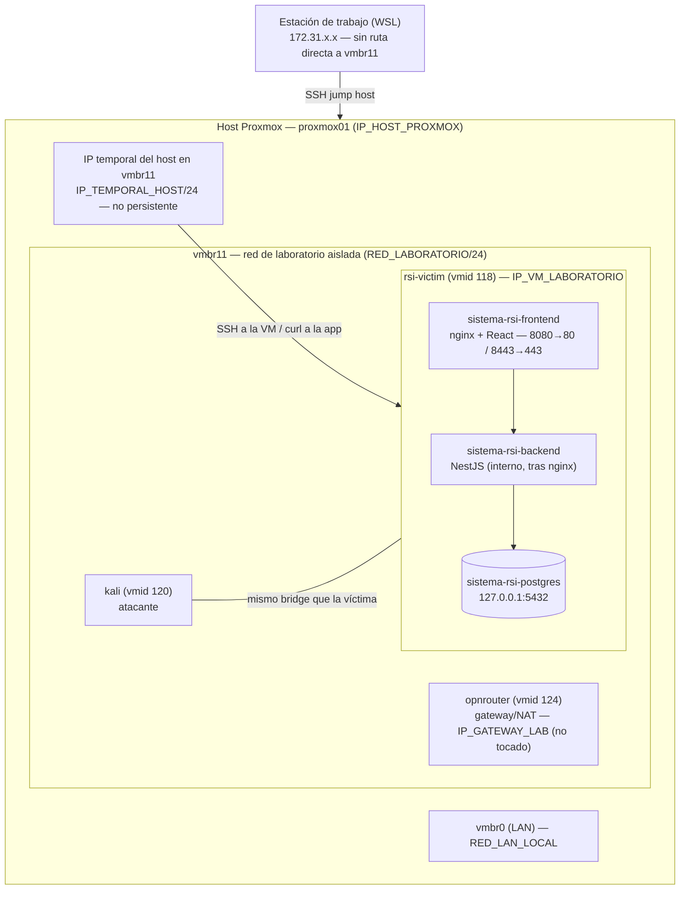
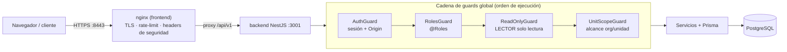

# Entorno de despliegue

## Topología

Esta sesión corrió en WSL (`172.31.x.x`), **sin ruta directa** a `vmbr11`. Todo el acceso a la
red de laboratorio pasó por SSH al host Proxmox como *jump host* (y una IP temporal agregada al
host en `vmbr11` para poder rutear).

## Arquitectura de la aplicación y cadena de autorización

Flujo de una petición y los cuatro guards globales (`app.module.ts`) por los que pasa, en orden.
La mayoría de los hallazgos de autorización están en el último, `UnitScopeGuard`.

## VM `rsi-victim` (vmid 118)

- Clonada (full clone) de la VM existente `ubuntu` (vmid 128).
- 2 vCPU, 3GB RAM, disco 20GB (`nvme`, lvmthin).
- Red: `vmbr11` (la misma que `kali`, vmid 120), MAC `BC:24:11:E0:4E:07`.
- IP asignada por DHCP: `<IP_VM_LABORATORIO>`.
- OS: Ubuntu 24.04.5 LTS (cloud-init, usuario `root`).
- Acceso: SSH con clave propia inyectada vía cloud-init (`sshkeys` + reset de la VM), no se usó
  ninguna contraseña existente.

### Limpieza al heredar el clon

La VM `ubuntu` original tenía processes/containers de otro proyecto del usuario corriendo
(`openclaw`/`nemoclaw`, un gateway tipo agente). Esto llenó el disco al 99% (6.5GB de imágenes
Docker viejas) y agregaba superficie de ataque ajena al ejercicio:

- Se detuvo y borró el contenedor `openshell-cluster-nemoclaw` y todas las imágenes/volúmenes
  Docker preexistentes (`docker system prune -a -f --volumes`) → liberó ~6.5GB.
- Se mató el proceso `node .../openclaw/dist/index.js gateway --port 18789 --bind lan` (no era
  un servicio systemd, no respawneó).
- Se detuvo y deshabilitó un `nginx` del host (fuera de Docker) que escuchaba en el puerto 80
  con una config vieja (`sites-enabled/openclaw`), ajeno a sistema-rsi.

Resultado: la única superficie expuesta en la VM es `22` (SSH), `8080`/`8443` (sistema-rsi).

## Cómo se desplegó sistema-rsi

El repo se había clonado localmente el 2026-10-14 (ahora da 404 — probablemente lo pusieron
privado). Como la red `vmbr11` sí tiene salida a internet vía NAT del router, pero el repo ya
no es accesible, se subió el código empaquetado (`tar.gz`, sin `.git`) por `scp` a través del
jump SSH.

Pasos aplicados dentro de la VM (`/root/sistema-rsi`):

1. `cp .env.example .env` y ajustes:
   - `TOTP_ENCRYPTION_KEY` generada con `openssl rand -hex 32`.
   - `POSTGRES_PASSWORD` / `DATABASE_URL` con password aleatoria (`openssl rand -hex 16`).
   - `PUBLIC_ORIGIN=https://<IP_VM_LABORATORIO>:8443`
   - `SESSION_ALLOWED_ORIGINS=https://<IP_VM_LABORATORIO>:8443`
   - `FRONTEND_BIND_ADDRESS=0.0.0.0` (el default es `127.0.0.1`, para poder llegar desde fuera
     de la VM).
   - `BOOTSTRAP_ADMIN_EMAIL` / `BOOTSTRAP_ADMIN_PASSWORD` agregadas para `crear-admin.mjs`.
   - Copiado también a `backend/.env` (Prisma corre desde esa carpeta).
2. Certificado TLS autofirmado generado con `openssl req -x509` (CN/SAN = `<IP_VM_LABORATORIO>`),
   colocado en `infrastructure/nginx/certs/`.
3. `docker compose up -d postgres`.
4. En `backend/`: `npm ci`, `npx prisma generate`, `npx prisma migrate deploy` (14 migraciones
   aplicadas).
5. `node scripts/crear-admin.mjs` → usuario ADMINISTRADOR inicial.
6. `node scripts/seed-demo.mjs` → 60 registros de datos demo (organización ficticia
   "Logística del Ceibo").
7. `docker compose up -d --build` → construye e inicia `backend` y `frontend`.
8. Setup de MFA del admin vía API (obligatorio por rol ADMINISTRADOR/RSI): `POST /auth/mfa/setup`
   → generar TOTP con el secreto devuelto → `POST /auth/mfa/confirm`.
9. Creación de usuarios demo de los otros 3 roles vía API, vinculados a trabajadores del seed
   (ver [02-credenciales.md](02-credenciales.md)).

## Acceso de red usado durante el despliegue

Como esta sesión no tiene ruta a `vmbr11`, se resolvió así:

1. Se generó un par de llaves SSH para el **host Proxmox** y el usuario agregó la pública a
   `/root/.ssh/authorized_keys` manualmente.
2. Se generó un segundo par de llaves SSH para la **VM rsi-victim**, inyectado vía
   `update_vm_config` (`sshkeys`) + reinicio de la VM (cloud-init la aplica en el próximo boot).
3. El host Proxmox no tenía IP en `vmbr11` (es un bridge L2 puro para las VMs). Se le agregó
   temporalmente `<IP_TEMPORAL_HOST>/24` con `ip addr add ... dev vmbr11` para poder rutear.
4. Con eso, todo el acceso a la VM se hace con `ssh -J` (jump host) desde esta sesión:
   `cliente local → (jump) host Proxmox <IP_HOST_PROXMOX> → (destino) rsi-victim <IP_VM_LABORATORIO>`.

Ver [04-bitacora-comandos.md](04-bitacora-comandos.md) para los comandos exactos y las rutas
de las claves.

**Nota de alcance:** no se tocó la configuración de `opnrouter` (el firewall/gateway real de la
red) ni se instaló nada en `kali`. El único cambio persistente en infraestructura ajena al
laboratorio es la IP temporal en el host (no sobrevive un reinicio del host).
