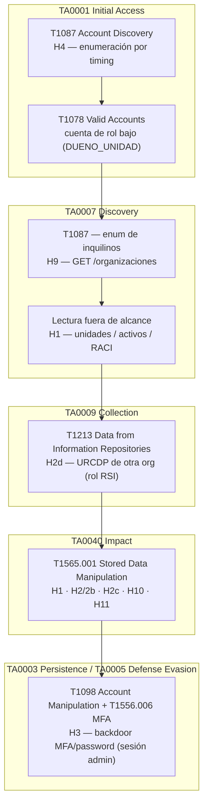

# Mapeo de hallazgos: OWASP / CWE / MITRE ATT&CK

> **Nota metodológica.** MITRE ATT&CK describe *comportamientos de adversario* (TTPs),
> pensado sobre todo para detección y emulación, no para clasificar vulnerabilidades de
> aplicaciones web. Para debilidades de código la taxonomía primaria y más precisa es
> **OWASP Top 10 (2021)** y **CWE**. Abajo se da esa clasificación primaria y, además, el
> encaje con ATT&CK (Enterprise), indicando el **nivel de ajuste**: 🟢 fuerte, 🟡 parcial,
> 🔴 flojo/conceptual. Se incluye ATT&CK porque suele pedirse para alinear el informe con la
> operación de un SOC / Blue Team.

## Tabla por hallazgo

| # | Hallazgo | OWASP 2021 | CWE | ATT&CK (táctica → técnica) | Ajuste |
|---|---|---|---|---|---|
| 1 | Control de acceso roto en `/organizaciones/*` | A01 Broken Access Control | CWE-284 / CWE-639 | TA0001 Initial Access → T1190 Exploit Public-Facing Application; TA0040 Impact → T1565.001 Stored Data Manipulation | 🟡 |
| 2 / 2b | IDOR por `activoId` (riesgos/incidentes) | A01 | CWE-639 IDOR / CWE-285 | T1190; T1565.001 | 🟡 |
| 2c | IDOR cross-org en `/cumplimiento/hitos/:id` | A01 | CWE-639 | T1190; T1565.001 | 🟡 |
| 2d | Rol `RSI` sin alcance → datos personales URCDP de otra org | A01 | CWE-284 / CWE-863 | TA0009 Collection → T1213 Data from Information Repositories; T1565.001 | 🟢 |
| 3 | Mass assignment en `PATCH /auth/usuarios/:id` (backdoor MFA/password) | A08 Software and Data Integrity Failures / A04 Insecure Design | CWE-915 Mass Assignment / CWE-284 | TA0003 Persistence → T1098 Account Manipulation; TA0005 Defense Evasion → T1556.006 Modify Authentication Process: MFA | 🟢 |
| 4 | Enumeración de usuarios por timing | A07 Identification & Auth Failures | CWE-204 Observable Response Discrepancy / CWE-203 | TA0007 Discovery → T1087.001 Account Discovery: Local Account | 🟢 |
| 4b | Replay de código TOTP | A07 | CWE-294 Authentication Bypass by Capture-replay | TA0006 Credential Access → T1111 MFA Interception (afín); habilita T1078 Valid Accounts | 🔴 |
| 9 | Enumeración cross-org (`GET /organizaciones`) | A01 | CWE-285 / CWE-200 Information Exposure | TA0007 Discovery → T1087 / T1526-like enumeración de inquilinos | 🟡 |
| 10 | Creación de procesos sin alcance | A01 / A04 Insecure Design | CWE-284 | TA0040 Impact → T1565.001 Stored Data Manipulation | 🔴 |
| 11 | Falta de segregación de funciones al aprobar riesgos | A04 Insecure Design / A01 | CWE-285 / CWE-862 Missing Authorization | TA0040 Impact → T1565.001 | 🔴 |

Hallazgos descartados (CSV injection → CWE-1236; XSS almacenado → A03/CWE-79) no se mapean a
ATT&CK porque no se demostraron.

## Cadena de ataque (por tácticas ATT&CK)

Ejemplo de cómo un atacante con una cuenta legítima de rol bajo (`DUENO_UNIDAD`) encadenaría los
hallazgos — útil para que el Blue Team piense detección en cada paso:

1. **Initial Access — T1078 Valid Accounts / T1190 Exploit Public-Facing Application.**
   El atacante parte de una cuenta válida de poco privilegio (o abusa de la app expuesta). Antes,
   con **T1087 Account Discovery** (H4, enumeración por timing) pudo descubrir correos válidos.
2. **Discovery — T1087 / enumeración de inquilinos.**
   `GET /organizaciones` (H9) le revela todas las organizaciones; lee unidades/activos/RACI fuera
   de su alcance (H1) para mapear el objetivo.
3. **Collection — T1213 Data from Information Repositories.**
   Si además tuviera rol `RSI`, accede a los registros de datos personales (URCDP) de cualquier
   organización (H2d).
4. **Impact — T1565.001 Stored Data Manipulation.**
   Modifica unidades/organización ajenas (H1), crea riesgos/incidentes sobre activos ajenos
   (H2/2b), edita o borra hitos de otra organización (H2c), auto-aprueba riesgos (H11) o crea
   procesos huérfanos (H10).
5. **Persistence / Defense Evasion — T1098 Account Manipulation + T1556.006 (MFA).**
   Si consigue (o ya tiene) una sesión `ADMINISTRADOR`, el mass assignment (H3) le permite
   plantar una semilla TOTP conocida o un hash de contraseña en cualquier cuenta — incluido otro
   administrador — manteniendo acceso de forma sigilosa.

## Detección / mitigación (orientación Blue Team)

- **T1087 / timing (H4):** alertar sobre ráfagas de `POST /auth/login` con muchos correos
  distintos y 401; el rate-limit de nginx ya ayuda. Igualar tiempos de respuesta (hash señuelo).
- **T1098 / T1556.006 (H3):** auditar cambios en `Usuario` sobre campos sensibles
  (`passwordHash`, `mfaSecret`, `mfaConfirmado`); el sistema ya tiene `AuditEvent` — conviene
  alertar cuando esos campos cambian fuera del flujo normal de enrolamiento. Raíz: `ValidationPipe`
  con whitelist.
- **T1565.001 (H1/H2/2c/10/11):** registrar y revisar escrituras donde el `organizacionId`/
  `unidadOrganizativaId` del recurso ≠ el del actor. Raíz: reescribir `UnitScopeGuard` para
  resolver el recurso real (no por substring del path) y aplicar alcance también al rol `RSI`.
- **T1213 (H2d):** lo mismo, extendido a las exportaciones y al módulo URCDP.

## Referencias de técnicas

- T1190 Exploit Public-Facing Application · T1078 Valid Accounts · T1087(.001) Account Discovery
- T1098 Account Manipulation · T1556.006 Modify Authentication Process: Multi-Factor Authentication
- T1111 Multi-Factor Authentication Interception · T1213 Data from Information Repositories
- T1565.001 Data Manipulation: Stored Data Manipulation
